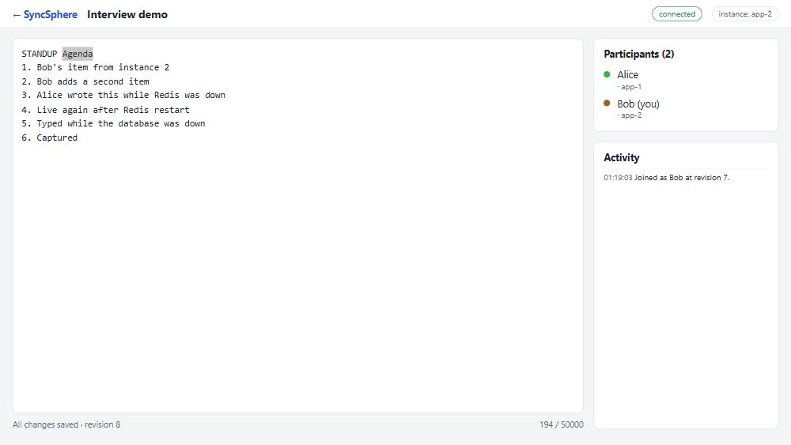
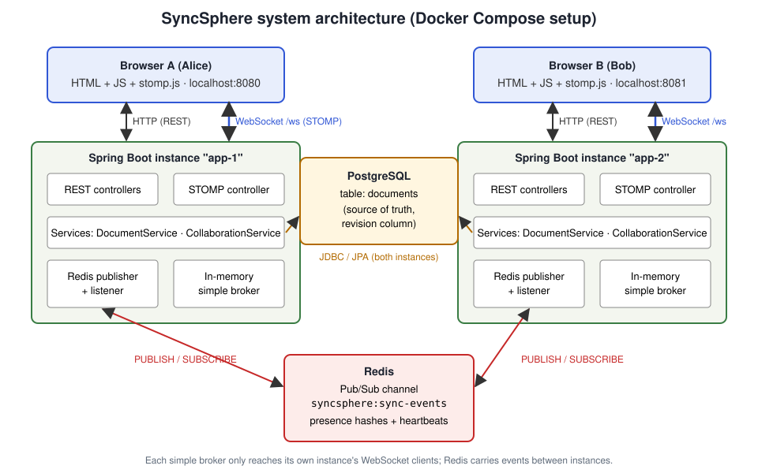

# SyncSphere — Distributed Real-Time Collaboration Platform

SyncSphere is a web application where several people open the same document and edit it together in real
time. Edits travel over **WebSockets (STOMP)**, are checked against a **revision number** so nobody silently
overwrites a newer version, are stored in **PostgreSQL**, and are fanned out between multiple application
instances through **Redis Pub/Sub**. The Docker setup runs **two instances** of the app, so you can see a user
on instance 1 and a user on instance 2 collaborating.

It is a deliberately focused portfolio project: one modular Spring Boot application, plain
HTML/CSS/JavaScript, and an honest, documented synchronization model.



*Bob's browser, connected to instance `app-2`, editing together with Alice on `app-1`.*

---

## Contents

- [Features](#features) · [Tech stack](#tech-stack) · [Architecture](#architecture-overview)
- [Quick start with Docker](#quick-start-with-docker-no-java-needed) · [Local development](#local-development-java--maven)
- [Tests](#tests) · [Configuration](#environment-variables) · [HTTP API](#http-api) · [STOMP destinations](#websocketstomp-destinations)
- [Troubleshooting](#troubleshooting) · [Known limitations](#known-limitations) · [Documentation](#documentation) · [Future work](#future-improvements)

## Features

What is implemented and verified (see [Verification](#what-was-verified)):

- **Documents**: create, list (newest first), open by ID; content and metadata stored in PostgreSQL.
- **Real-time editing** over STOMP: every accepted edit is broadcast to everyone in the document.
- **Revision-based conflict detection**: each edit carries the revision it was based on. Stale edits are
  rejected (never silently applied) and the sender gets the latest snapshot. A JPA `@Version` optimistic lock
  also catches the race where two instances accept an edit at the same moment.
- **Client-side recovery from conflicts**: the browser re-applies a rejected change on top of the newer
  version *when the two changes do not overlap*; overlapping changes are shown in a "rejected draft" panel.
- **Join snapshot**: a user joining (or reconnecting) receives the current authoritative document.
- **Presence**: live participant list with join/leave events, shared across instances via Redis.
  Disconnected users are removed (WebSocket close or missed STOMP heartbeats); participants of a crashed
  instance are pruned through per-instance heartbeat keys, and an instance that restarts under the same ID
  removes its own leftover entries at startup.
- **Cursor/selection sharing**: participants see each other's caret position (line/column, selection length).
  Cursor positions are never persisted.
- **Multi-instance fan-out with Redis Pub/Sub**, with event-ID de-duplication and a local-delivery fallback
  when Redis is unreachable.
- **Recovery from missed events**: the browser periodically compares its revision with the database and
  catches up from a snapshot (Redis Pub/Sub does not store messages).
- **Validation and destination allow-listing** for REST and STOMP; RFC 7807 error responses; 503 when a data
  store is down.
- **Docker Compose** environment (PostgreSQL + Redis + 2 app instances) with health-gated startup.

What it does **not** do: there is no login, no operational transformation (OT) and no CRDT. See
[Known limitations](#known-limitations).

## Tech stack

| Layer | Technology |
|---|---|
| Language / runtime | Java 21 (the Docker image uses Eclipse Temurin 21) |
| Framework | Spring Boot 3.5 (Web, WebSocket/STOMP, Data JPA, Data Redis, Validation, Actuator) |
| Database | PostgreSQL 17, schema managed by Flyway |
| Messaging between instances | Redis 7 Pub/Sub (Lettuce client) |
| Frontend | Plain HTML, CSS and JavaScript modules; `@stomp/stompjs` served from a WebJar |
| Build | Maven (via the included Maven Wrapper `mvnw`) |
| Tests | JUnit 5, Spring Boot Test, Testcontainers (PostgreSQL + Redis), Node's built-in test runner for the JS merge helpers |
| Packaging | Multi-stage Dockerfile, Docker Compose |

## Architecture overview



- **Browser** – renders the editor, sends edits/cursor moves over STOMP, applies updates, recovers from
  conflicts and missed events.
- **Spring Boot instance** – REST API for documents, STOMP endpoint `/ws` for live collaboration, revision
  checks, persistence, and an in-memory STOMP broker that reaches *only this instance's* clients.
- **PostgreSQL** – the single source of truth for document content and revision numbers.
- **Redis** – carries synchronization events between instances (Pub/Sub) and stores shared, temporary
  presence data.

**The life of one edit** (the 8 steps referenced throughout the docs):

1. A user changes the document in the browser.
2. The browser sends a STOMP `SEND` to `/app/documents/{id}/edit` with `{baseRevision, content, clientEditId}`.
3. The server validates the frame (destination allow-list, Bean Validation, "has this connection joined?").
4. `DocumentService.applyEdit` compares `baseRevision` with the stored revision; a mismatch is a conflict.
5. The new content is committed to PostgreSQL; `@Version` turns the `UPDATE` into a compare-and-set.
6. Only after the commit, `SyncEventPublisher` publishes a `DOCUMENT_UPDATED` event to Redis.
7. Every instance (including the sender's) receives the event, drops duplicates by `eventId`, and
8. forwards it to its subscribed WebSocket clients on `/topic/documents/{id}`.

Details: [docs/ARCHITECTURE.md](docs/ARCHITECTURE.md).

## Quick start with Docker (no Java needed)

Prerequisites: Docker Desktop (or Docker Engine + the Compose plugin). Ports 8080, 8081, 5432 and 6379 free
(or change them in a `.env` file, see [.env.example](.env.example)).

```bash
docker compose up --build
```

This builds the image (the first build downloads Maven dependencies and takes a few minutes), then starts
PostgreSQL and Redis, waits until both are healthy, and starts the two app instances.

Then:

A scripted five-minute version (with what to point out in an interview) is in [docs/DEMO.md](docs/DEMO.md).

1. Open <http://localhost:8080>, enter a name, create a document.
2. Copy the document URL, change the port to **8081**, and open it in a second browser window
   (a private window works well because the display name is stored per browser/origin).
3. Type in either window. The badge in the top-right corner shows which instance each window is using.

Useful commands:

```bash
docker compose ps
```

```bash
docker compose logs -f app-1 app-2
```

```bash
docker compose down
```

```bash
docker compose down -v
```

`docker compose ps` lists the containers and their health; `logs -f` follows the application logs;
`down` stops and removes the containers but **keeps** the database volume; `down -v` also deletes the volume
(all documents).

## Local development (Java + Maven)

Prerequisites: JDK 21 or newer, Docker (for PostgreSQL/Redis and for the tests). Maven itself is not needed,
the wrapper downloads it.

Start only the infrastructure:

```bash
docker compose up -d postgres redis
```

Run the application from source (defaults in `application.yml` point at `localhost:5432` and `localhost:6379`):

```bash
./mvnw spring-boot:run
```

On Windows PowerShell or cmd use `mvnw.cmd spring-boot:run`. The app listens on <http://localhost:8080>.
To run a second local instance, give it another port and instance ID:

```bash
SERVER_PORT=8082 SYNCSPHERE_INSTANCE_ID=local-2 ./mvnw spring-boot:run
```

More in [docs/DEVELOPMENT.md](docs/DEVELOPMENT.md).

## Tests

```bash
./mvnw test
```

Runs 47 Java tests. Docker must be running: 35 of them are integration tests that start throwaway
PostgreSQL and Redis containers with Testcontainers (no Compose stack needed). They cover the REST API,
revision conflicts (including a six-thread race), WebSocket broadcast, presence (including cleanup after a
crash or a failed removal), cursor relay, Redis delivery
with de-duplication, and a **two-instance test** that boots a second Spring context and checks that an edit
on instance 1 reaches a client on instance 2 only via Redis.

The browser merge helpers have their own tests (Node 18+, no npm install):

```bash
node --test src/test/js/merge.test.mjs
```

## Environment variables

| Variable | Used by | Default (development only) | Meaning |
|---|---|---|---|
| `DB_URL` | app | `jdbc:postgresql://localhost:5432/syncsphere` | JDBC URL |
| `DB_USERNAME` | app | `syncsphere` | DB user |
| `DB_PASSWORD` | app | `syncsphere_dev_password` | DB password |
| `REDIS_HOST` / `REDIS_PORT` | app | `localhost` / `6379` | Redis address |
| `REDIS_PASSWORD` | app | *(empty)* | Redis password, if any |
| `SERVER_PORT` | app | `8080` | HTTP port |
| `SYNCSPHERE_INSTANCE_ID` | app | `local-<random>` | Name shown in logs/UI; must differ per instance |
| `SYNCSPHERE_ALLOWED_ORIGINS` | app, compose | `http://localhost:*,http://127.0.0.1:*` | Origins allowed to open the WebSocket |
| `SYNCSPHERE_REDIS_CHANNEL` | app | `syncsphere:sync-events` | Pub/Sub channel name |
| `POSTGRES_DB` / `POSTGRES_USER` / `POSTGRES_PASSWORD` | compose | `syncsphere` / `syncsphere` / `syncsphere_dev_password` | Database container settings |
| `APP1_PORT` / `APP2_PORT` | compose | `8080` / `8081` | Host ports of the two instances |
| `POSTGRES_HOST_PORT` / `REDIS_HOST_PORT` | compose | `5432` / `6379` | Host ports (bound to 127.0.0.1) |

No real secrets are committed. `.env` is git-ignored; copy [.env.example](.env.example) to start one.

## HTTP API

| Method & path | Description | Success | Errors |
|---|---|---|---|
| `POST /api/documents` | Create `{ "title": "...", "content": "..." }` (content optional) | `201` + `Location` + document | `400` validation / bad JSON |
| `GET /api/documents` | Up to 100 most recently edited documents (no content) | `200` | |
| `GET /api/documents/{id}` | Full snapshot `{id,title,content,revision,createdAt,updatedAt}` | `200` | `400` bad UUID, `404` |
| `GET /api/documents/{id}/participants` | Currently connected participants (all instances) | `200` | `404`, `503` if Redis is down |
| `GET /api/instance` | `{ "instanceId": "app-1" }` | `200` | |
| `GET /actuator/health/readiness` | `UP` only if PostgreSQL **and** Redis are reachable | `200` | `503` |

All errors use RFC 7807 JSON. A database or Redis outage returns `503`. Full details:
[docs/API-AND-MESSAGING.md](docs/API-AND-MESSAGING.md).

## WebSocket/STOMP destinations

Endpoint: `ws://<host>:<port>/ws` (plain WebSocket, STOMP 1.2, heartbeats every 10 s).

| Direction | Destination | Payload |
|---|---|---|
| client → server | `/app/documents/{id}/join` | `{ "displayName": "Alice" }` |
| client → server | `/app/documents/{id}/edit` | `{ "baseRevision": 4, "content": "...", "clientEditId": "..." }` |
| client → server | `/app/documents/{id}/cursor` | `{ "revision": 4, "selectionStart": 10, "selectionEnd": 15 }` |
| server → subscribers | `/topic/documents/{id}` | `DOCUMENT_UPDATED` event |
| server → subscribers | `/topic/documents/{id}/presence` | `PRESENCE_CHANGED` event (`JOINED`/`LEFT`) |
| server → subscribers | `/topic/documents/{id}/cursors` | `CURSOR_MOVED` event |
| server → one client | `/user/queue/snapshot` | reply to `join`: document + you + participants |
| server → one client | `/user/queue/errors` | `{ "code": "REVISION_CONFLICT", "message": ..., "latest": {...} }` etc. |

Frames to any other destination (for example a client `SEND` straight to `/topic/...`) are dropped and logged.

## Troubleshooting

| Symptom | Likely cause / fix |
|---|---|
| `Bind for 0.0.0.0:8080 failed: port is already allocated` | Another process uses the port. Set `APP1_PORT` (or the other port variables) in `.env`. |
| App container keeps restarting, log shows `Connection to postgres:5432 refused` | PostgreSQL not ready or wrong credentials. `docker compose logs postgres`; if you changed `POSTGRES_PASSWORD` after the volume was created, the old password is still in the volume (`docker compose down -v` resets it, deleting data). |
| Status pill says `reconnecting` | The WebSocket is down (app restarting?). The page reconnects and resynchronizes automatically. |
| WebSocket handshake fails with 403 | The page's origin is not in `SYNCSPHERE_ALLOWED_ORIGINS`. |
| `./mvnw test` fails with `Could not find a valid Docker environment` | Testcontainers needs a running Docker daemon. |
| Edits on one instance do not show up on the other | Check Redis: `docker compose exec redis redis-cli PUBSUB NUMSUB syncsphere:sync-events` should report 2 subscribers. Clients still catch up within ~15 s through the snapshot resync. |

More: [docs/DEVELOPMENT.md](docs/DEVELOPMENT.md).

## Known limitations

- **No authentication.** The display name is free text, not an identity. Anyone who can reach the server and
  knows a document ID can read and edit it. The server does assign each connection a random participant ID
  and colour that the client cannot forge. See "Security model" in [docs/ARCHITECTURE.md](docs/ARCHITECTURE.md).
- **Whole-document replacement, not OT/CRDT.** Each edit sends the full text (max 50,000 characters).
  Concurrent edits are serialized by the revision check; the browser can merge two changes only when they
  touch different regions. Heavy simultaneous typing in the same paragraph causes rejected drafts.
  A CRDT (e.g. Yjs/Automerge-style sequence CRDT) would merge character-level operations instead.
- **Write-through persistence**: every accepted edit is a database transaction. Simple and durable once
  acknowledged, but not designed for very high edit rates.
- **Redis Pub/Sub is not durable**: events published while an instance is disconnected are lost; clients
  recover through snapshot resync (up to ~15 s delay). Every instance receives every event (one channel).
- **No benchmarks were run.** No latency or throughput numbers are claimed.
- The STOMP broker is Spring's in-memory simple broker (one per instance); there are no per-user rate limits.

## What was verified

On the development machine (Windows 11, Docker Desktop 29, JDK 26 for local builds, Temurin 21 in the image):

- `./mvnw clean verify`: 47 tests passed; `node --test src/test/js/merge.test.mjs`: 7 passed.
- `docker compose up --build`: all four containers healthy; Flyway applied V1 once while both instances started.
- Two browser tabs on `:8080` and `:8081` edited one document; updates, presence and cursor positions crossed
  instances; a non-overlapping concurrent edit was merged; an overlapping one produced a rejected draft.
- Restarting `app-1`, `docker kill` + restart of `app-1`, stopping/starting Redis, stopping/starting
  PostgreSQL and `docker compose down`/`up` all recovered as documented (details in [docs/DEVELOPMENT.md](docs/DEVELOPMENT.md#8-manual-verification-checklist)).

## Documentation

- [docs/ARCHITECTURE.md](docs/ARCHITECTURE.md) — design decisions, event flows, failure modes, trade-offs
- [docs/API-AND-MESSAGING.md](docs/API-AND-MESSAGING.md) — endpoints, STOMP destinations, payloads, errors
- [docs/DEVELOPMENT.md](docs/DEVELOPMENT.md) — workflow, tests, migrations, Docker, debugging
- [docs/DEMO.md](docs/DEMO.md) — a five-minute, reproducible two-browser demo and the screenshots worth taking

## Future improvements

- Authentication (Spring Security + OAuth2/OIDC) and per-document access control, including STOMP-level
  authorization.
- Character-level operations with a CRDT library, so concurrent edits in the same region merge.
- Per-document Redis channels (instances subscribe only to documents they serve) or Redis Streams for
  replayable events.
- An edit history table (append-only) to enable undo and auditing.
- A reproducible latency benchmark.
