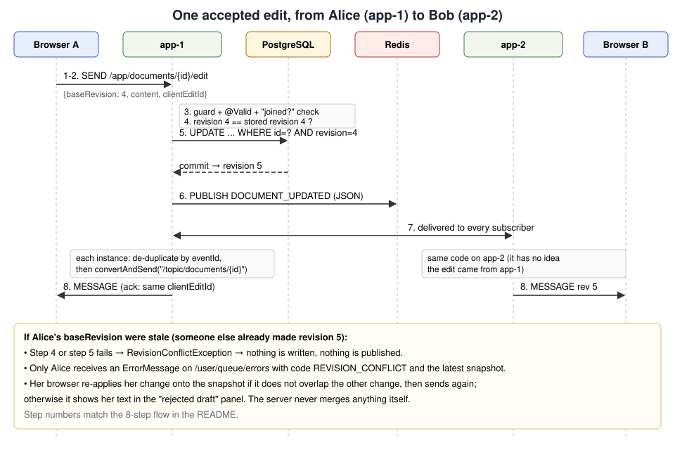
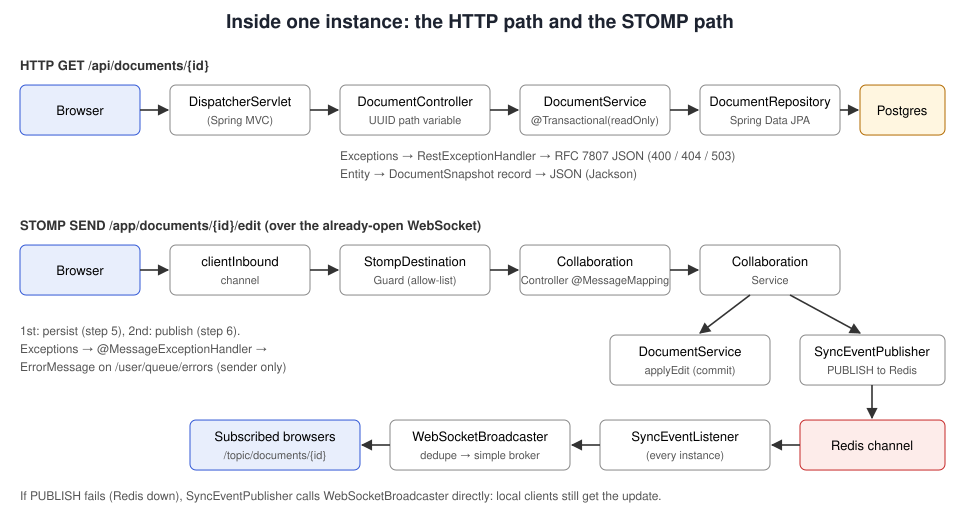

# SyncSphere architecture

This document explains *why* SyncSphere is built the way it is: the system boundaries, the main event flows,
what happens when things fail, and which trade-offs were made on purpose.


## 1. System boundaries

| Component | Owns | Does not own |
|---|---|---|
| Browser (`src/main/resources/static`) | The user's unsent text, the "one edit in flight" state machine, client-side merge of non-overlapping changes, rendering presence | Any authority over revisions or content |
| Spring Boot instance | Validation, revision checks, transactions, publishing events, delivering events to *its own* WebSocket sessions | Other instances' WebSocket sessions |
| PostgreSQL | Document content, title, revision, timestamps — the **source of truth** | Presence, cursors, messages in transit |
| Redis | Event transport between instances (Pub/Sub); shared temporary presence | Anything that must survive a Redis restart |

It is **one deployable application** (a modular monolith) that can run as N identical instances. There are no
microservices: the parts that change together (document rules, messaging, presence) are deployed together.

### Package layout

```
com.syncsphere
├── SyncSphereApplication        entry point (+ @EnableScheduling for the presence heartbeat)
├── config/                      WebSocketConfig, RedisConfig, SyncSphereProperties
├── document/                    entity, repository, DocumentService (revision rules), REST controller, DTOs
├── collaboration/               STOMP controller, CollaborationService, PresenceService, destination guard,
│                                handshake handler, STOMP payload records
├── sync/                        SyncEvent + 3 event records, Redis publisher/listener, WebSocketBroadcaster,
│                                RecentEventIds (duplicate filter)
└── web/                         RestExceptionHandler, InstanceInfoController
```

Package-by-feature keeps every file related to "documents" or "sync" next to each other.

## 2. Key design decisions

### 2.1 Whole-document snapshots + revision numbers (not OT, not CRDT)

Every edit message contains the **complete text** and the **revision it was based on**. The server accepts it
only if that revision is still the latest; the accepted edit becomes revision `N+1`.

Why:
- It is easy to reason about: the server never has to merge text, so it can never merge it wrongly.
- Every update is self-contained, so a client that missed events can jump straight to the newest state.
  Reordered or duplicated updates are harmless (clients ignore revisions they already have).
- It makes "prevent silent overwriting" a single comparison plus a database guarantee.

Costs:
- Bandwidth grows with document size (each edit carries up to 50,000 characters).
- Two people typing in the same region at the same moment conflict often. The client-side three-way merge
  (`merge.js`) handles changes in *different* regions; overlapping changes are given back to the user as a draft.

**How a CRDT would improve this:** with a sequence CRDT (the approach used by libraries like Yjs or Automerge)
every character insert/delete becomes an operation with a unique ID and a position defined relative to
neighbouring characters. Replicas can apply operations in any order and still converge, so no edit is ever
rejected and two people can type in the same sentence. The price is a more complex data model (tombstones,
metadata per character, garbage collection) and a different persistence model (operation log + compaction).
SyncSphere does not implement this.

### 2.2 Two layers of conflict detection

`DocumentService.applyEdit`:

1. **Explicit check** — `if (document.getRevision() != baseRevision) throw RevisionConflictException`.
2. **Optimistic lock** — the `revision` column is a JPA `@Version`. Hibernate's UPDATE is
   `UPDATE documents SET ..., revision = N+1 WHERE id = ? AND revision = N`. If two transactions (possibly on
   two instances) both passed step 1, only the first commit matches a row. The second gets an
   `OptimisticLockingFailureException`, translated to the same conflict.

Step 1 alone has a race window; step 2 alone would still work but gives a less clear code path. The
integration test `concurrentEditsOnTheSameRevisionProduceExactlyOneWinner` runs six simultaneous writers and
asserts exactly one wins.

### 2.3 Write-through persistence

Each accepted edit is committed to PostgreSQL **before** it is announced. Consequences:

- When a client sees its own edit acknowledged, the edit is committed (durable to the extent PostgreSQL's own
  configuration guarantees; nothing beyond that is claimed).
- An application restart loses nothing that was acknowledged.
- Cost: one transaction per accepted edit. The client limits this by debouncing typing (250 ms) and keeping
  at most one edit in flight per browser.

Alternatives considered: buffering edits in memory/Redis and flushing periodically (faster, but acknowledged
edits could be lost on a crash) or storing an operation log (needed for OT/CRDT, more complex).

### 2.4 Publish after commit

`CollaborationService.submitEdit` is *not* transactional. It calls the transactional
`DocumentService.applyEdit` (the transaction commits when that call returns) and only then publishes the event.
Publishing inside the transaction could announce an edit that later rolls back.

If the process crashes between commit and publish, the edit is saved but not broadcast; other clients pick it
up through the periodic snapshot resync.

### 2.5 One delivery path through Redis

The publishing instance does **not** send the update directly to its own clients. It publishes to Redis, and
every instance (itself included) delivers what it receives. This keeps one code path and avoids local
duplicates. Fallback: when the Redis publish throws, the publisher delivers locally so users on the same
instance keep working.

Duplicates are still possible in one situation: the publish times out *after* Redis accepted it, so the
fallback delivers locally and the subscriber later delivers the same event again. `WebSocketBroadcaster`
therefore drops event IDs it has already seen (bounded to the last 10,000, see `RecentEventIds`). Clients add
a second line of defence by ignoring revisions they already have.

### 2.6 A single Redis channel

All events use `syncsphere:sync-events`; every instance receives every event and the in-memory broker discards
those without local subscribers. Per-document channels would reduce traffic for large deployments but would
require dynamic subscribe/unsubscribe bookkeeping as users come and go. For a few instances, one channel is
simpler and easier to debug (`redis-cli SUBSCRIBE syncsphere:sync-events` shows everything).

### 2.7 Presence in Redis with instance heartbeats

```
syncsphere:presence:{documentId}   HASH    participantId -> Participant JSON
syncsphere:instance:{instanceId}   STRING  "alive", TTL 30 s, refreshed every 10 s
```

- Normal leave: the WebSocket closes → `SessionDisconnectEvent` → `HDEL` + `LEFT` event.
- Dead connection without a close (laptop lid shut): STOMP heartbeats (10 s) time out → same disconnect event.
- Crashed instance: it stops refreshing its heartbeat key; `listParticipants` drops entries whose instance key
  has expired.
- Redis restart (empty dataset): each instance re-writes its own connected participants on every heartbeat.
- Instance killed and restarted under the same ID within 30 s: the heartbeat key never expires, so the old
  entries would look alive forever. At startup (`ApplicationReadyEvent`) each instance therefore deletes entries
  that name it but are not live local connections. Found by running `docker kill` on `app-1`.
- Redis unreachable when a user disconnects: the failed removal is remembered and retried on each heartbeat.

Presence events are deltas (one participant joined/left). The full list comes with the join snapshot and from
`GET /api/documents/{id}/participants`, which clients poll every 15 s to repair drift.

## 3. Event flows

### 3.1 Joining a document

1. Browser connects to `/ws`. `ParticipantHandshakeHandler` assigns a random `Principal` (= participant ID).
2. Browser subscribes to `/topic/documents/{id}`, `/presence`, `/cursors`, `/user/queue/snapshot`,
   `/user/queue/errors` — **before** joining, so no update falls between "snapshot taken" and "subscribed".
3. Browser sends `/app/documents/{id}/join` with a display name.
4. `CollaborationService.join` loads the snapshot (404 → `DOCUMENT_NOT_FOUND`), registers presence,
   publishes `PRESENCE_CHANGED/JOINED`, and the controller returns `JoinedMessage` to `/user/queue/snapshot`.
5. `JoinedDocument(documentId, participant)` is stored in the WebSocket session attributes; later edit/cursor
   frames use it instead of trusting anything in the payload.

`setPreserveReceiveOrder(true)` makes the server process one connection's frames in order, so the SUBSCRIBE
in step 2 is registered before the reply in step 4 is sent. The browser also guards against an update that
overtakes the snapshot (it never moves to a lower revision).

### 3.2 Editing



### 3.3 Conflict

The server sends `REVISION_CONFLICT` with the latest snapshot **only to the sender**. The browser computes its
own change (base → local) and the other change (base → latest) as single regions (common prefix/suffix). If
they do not overlap it re-applies its change on the latest text and sends it as a new edit based on the latest
revision; otherwise it shows the latest text and puts the user's text into the rejected-draft panel. Restoring
the draft is an explicit user decision.

### 3.4 Request flow inside one instance



## 4. Failure modes

| Failure | What users see | Why / recovery |
|---|---|---|
| A client misses a Pub/Sub message | Their view lags for ≤ ~15 s, then catches up | Periodic `GET /api/documents/{id}`; next edit would also conflict and deliver the snapshot |
| Redis down | Users on the **same** instance keep collaborating; other instances see the change after Redis returns (snapshot resync); presence list may be stale; `/participants` returns 503; readiness DOWN | Publisher falls back to local delivery; Lettuce reconnects; listener container re-subscribes; heartbeat re-registers presence |
| PostgreSQL down | Edits rejected with `SERVICE_UNAVAILABLE` (browser keeps the text and retries every 3 s); REST returns 503; readiness DOWN, liveness UP | Hikari connection timeout is 5 s; once the DB is back, the retried edit is committed |
| App instance restarts | WebSocket closes; browser shows "reconnecting", reconnects (possibly after a few seconds), rejoins and resynchronizes from the snapshot | Acknowledged edits are already in PostgreSQL |
| App instance crashes | Same as restart for its users; others see the crashed instance's participants disappear within ~30 s | Heartbeat TTL |
| App instance crashes and is restarted at once under the same ID | Old participant entries are removed when it starts | Startup sweep in `PresenceService.removeEntriesFromPreviousRun` |
| Two instances accept edits on the same revision simultaneously | One edit wins, the other user gets a conflict | `@Version` optimistic lock |
| Malformed or forged messages | Sender gets `VALIDATION_FAILED` / `INVALID_MESSAGE` (not retried automatically); frames to disallowed destinations are dropped | Bean Validation, `StompDestinationGuard`, listener ignores unreadable Redis messages and events without IDs |

Readiness vs liveness: when a dependency is down, `/actuator/health/readiness` reports DOWN (do not route
traffic) while liveness stays UP (do not kill the container: restarting would not fix PostgreSQL).

## 5. Security model (development-only)

Implemented:
- Bean Validation on every REST body and STOMP payload; UUID-typed path/destination variables.
- `StompDestinationGuard`: clients may SEND only to `/app/documents/{uuid}/(join|edit|cursor)` and SUBSCRIBE
  only to the three document topics and their own `/user/queue/(snapshot|errors)`. In particular a client
  cannot SEND to `/topic/...` (which, with the simple broker, would broadcast unvalidated content).
- Server-assigned participant IDs and colours; "join before edit" enforced per connection.
- WebSocket handshake origin check (`SYNCSPHERE_ALLOWED_ORIGINS`).
- Display names restricted to letters, digits, space and `. _ ' -`; the UI uses `textContent` everywhere.
- Inbound STOMP frames limited to 512 KB; documents to 50,000 characters (also a DB `CHECK` constraint).
- Titles and content may not contain the NUL character (U+0000), which PostgreSQL cannot store; without this
  rule such input failed inside the database and was reported as a 503 outage.
- No secrets in the repository; all credentials via environment variables.

Not implemented (would be required for production):
- **Authentication**: the display name is not an identity. With Spring Security you would authenticate the
  HTTP handshake (session cookie or OAuth2/OIDC token), Spring would put the authenticated `Principal` on the
  WebSocket session instead of our random one, and `spring-security-messaging` could authorize each
  destination per user.
- **Authorization**: anyone who knows a document UUID can read and edit it.
- Rate limiting of edits/cursor messages, TLS termination, CSRF protection for the REST POST, Redis AUTH/TLS.
- The origin check only stops *browsers* on other sites; non-browser clients can send any Origin header.

## 6. Scaling notes (not measured)

- Each instance handles its own WebSocket connections; adding instances adds connection capacity.
- All instances receive all events (single channel), and all edits go to one PostgreSQL primary.
- No load tests were run, so no capacity numbers are claimed.
